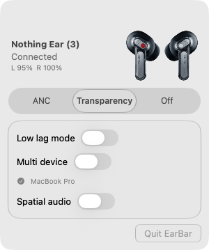
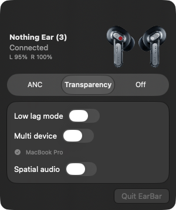

# EarBar

<p align="center"><a href="https://ko-fi.com/j0di3x"></a></p>

Native macOS menu bar app that controls Nothing Ear (3) and Sony WH-CH720N
headphones over Bluetooth RFCOMM. macOS 14+, Apple silicon, no third-party
packages.

Not affiliated with Nothing Technology or Sony.

<p align="center">
  
  
</p>

## Build

```
xcodebuild -scheme EarBar -configuration Release build
xcodebuild -scheme EarBar test
```

Tests use only packets captured from real headphones, stored in
`Tests/Fixtures/captured` (Sony packets in `Tests/Fixtures/captured/sony`).

## Targets

- `EarBar`: the menu bar app.
- `NothingProtocol`: packet encode and decode, without Bluetooth.
- `EarBar -previewWindow [-light|-dark]` also shows the panel in a normal window, with a
  generic device name, for README screenshots.
- `Spike`: logs every packet as hex to `~/Library/Logs/EarBarSpike`.
  `open Spike.app --args --probe` also sends read-only requests;
  add `--sony` for the WH-CH720N.

## Credits

The protocol is not public. No code was copied from these projects; their
documented protocol facts guided the work, and each fact is checked against
packets from real headphones.

- [BudsLink](https://github.com/maniacx/BudsLink) (GPL-3.0)
- [nothing-x-macos](https://github.com/nikiomori/nothing-x-macos) (GPL-3.0)
- [EarA](https://github.com/oneydef/EarA-linux) (GPL-3.0-or-later)
- [ear-web](https://github.com/radiance-project/ear-web) (GPL-3.0)
- [Creating a Linux controller for the Nothing Ear (2)](https://bharadwaj-raju.github.io/posts/nothing-ear-2-on-linux)
- [Gadgetbridge](https://codeberg.org/Freeyourgadget/Gadgetbridge) (AGPL-3.0-or-later), for the Sony protocol
